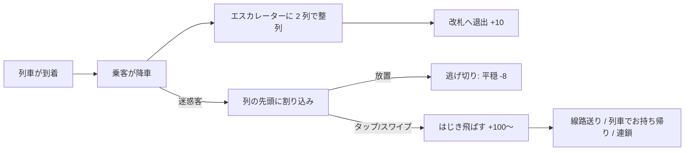
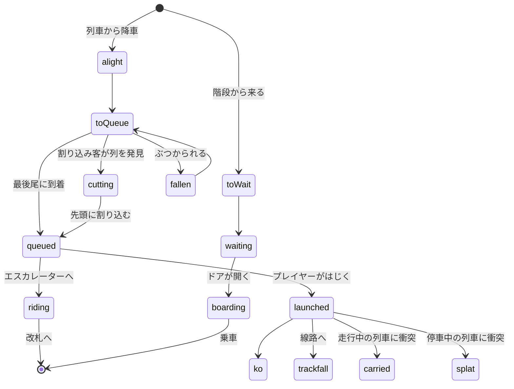

# Cut-in Killer (カットインキラー)

日本の都心部の駅ホームを舞台にしたカジュアルWebゲーム。割り込みをする行儀の悪いモブを排除し、行儀の良いモブが安全に退出できるようにサポートするゲームです。

**プレイ**: https://7474.github.io/cut-in-killer/

スマートフォンの縦画面・指 1 本で遊ぶことを前提にしています（PC ではマウスで操作できます）。

## ゲームの流れ



- 列車が着くたびに大勢の乗客が降り、エスカレーター前に 2 列で並びます。エスカレーターの処理能力には限りがあるため、ラッシュ時は列が伸びます。
- その列に**迷惑客**が紛れ込みます。放っておくと割り込み・転倒・乗車妨害が起き、画面上部の「ホームの平穏」が減ります。
- 平穏がゼロになると「ホーム騒然…」で終了。制限時間いっぱい守り切ればクリアで、残った平穏がボーナスになります。

## 操作（指 1 本）

| 操作 | 効果 |
| --- | --- |
| タップ | 指の近くにいる迷惑客を、近くの線路の方向へはじき飛ばす。周囲の迷惑客もまとめて吹き飛ぶ |
| スワイプ | 指を払った方向へ強く飛ばす。飛んだ迷惑客が別の迷惑客に当たると**連鎖** |

- 迷惑客は足元に色付きの輪が出ます。指の近くに迷惑客がいればそちらが優先され、行儀の良い乗客は体の真上をタップしたときだけ当たります。
- エスカレーターに乗った後でも、上り切る前ならはじき飛ばせます。

- 走行中の列車にぶつけると「お持ち帰り」で大量得点、停車中の列車や壁に当てても加点されます。
- 行儀の良い乗客を飛ばしてしまうと「誤爆」で減点。飛ばした迷惑客が巻き込んだ人も転びます（減点なし）。
- 迷惑客を排除するたびに平穏が少し回復するので、攻めるほど安定します。

## 登場人物

| 種類 | 見た目 | 行動 |
| --- | --- | --- |
| 一般の乗客 | 紺・グレー系の服 | 降車後エスカレーターの列の最後尾に並ぶ。階段から来た人はドア横に整列して乗車する |
| 割り込み客 | 赤い服 | 普段は普通に歩くが、列が見えると赤く光って先頭へ突進し割り込む |
| 歩きスマホ | 紫の服＋スマホの光 | ふらふら蛇行・急停止し、ぶつかった人を転ばせる |
| ドア前陣取り | 茶色の服＋大きなリュック | ドアの正面に立ちふさがって降車を妨げ、降りる人より先に乗り込む |

## ステージ

| 駅 | 構成 | 時間 | 特徴 |
| --- | --- | --- | --- |
| 新宿駅 | 片面ホーム・1 線 | 90 秒 | 割り込み客のみ。チュートリアル的な難易度 |
| 渋谷駅 | 島式ホーム・2 線 | 90 秒 | 歩きスマホとドア前陣取りが登場 |
| 東京駅 | 島式ホーム・2 線・エスカレーター 2 基 | 120 秒 | 通過列車あり。全種類の迷惑客が登場 |

各ステージのベストスコアとランク（S/A/B/C）はブラウザの localStorage に保存されます。

## 得点と平穏度

| イベント | スコア | 平穏 |
| --- | --- | --- |
| 迷惑客をはじき飛ばす | +100 × コンボ倍率（3.5 秒以内に続けると上昇、最大 5 倍） | +2 |
| 連鎖 | +80 | |
| 線路送り / 場外 | +50 | |
| 壁ドン / 停車中の列車にベチャッ | +30 | |
| 走行中の列車でお持ち帰り | +200 | |
| 一般客が改札へ / 列車へ | +10 / +5 | 改札へ +0.5 |
| 割り込まれた | | -1 |
| 迷惑客に逃げ切られた | -50 | -5 |
| 降りる人より先に乗られた | | -2（逃げ切りに加算） |
| 歩きスマホが人を転ばせた | | -1 |
| 誤爆 | -50 | -4 |
| 混雑超過 | | 毎秒 -1.5 |

## ローカルで起動

ビルド不要の静的サイトです。

```bash
python3 -m http.server 8080
```

ブラウザで http://localhost:8080/ を開きます。`index.html` を直接開いても動作します。

## 技術構成

- HTML5 Canvas 2D と素の JavaScript（ES2015+ のクラス、ビルドツール・外部ライブラリなし）
- 効果音は Web Audio API で合成（音声ファイルなし）
- 論理解像度 360×640 で計算し、画面サイズと devicePixelRatio に合わせて拡大描画

```
cut-in-killer/
├── index.html          # 画面（タイトル・遊び方・一時停止・リザルト）
├── styles/main.css
└── js/
    ├── config.js       # 定数・得点表・ステージ定義
    ├── util.js         # 数学ユーティリティと localStorage ラッパー
    ├── audio.js        # 効果音
    ├── effects.js      # パーティクル・浮かぶ文字・画面揺れ・ヒットストップ
    ├── station.js      # 列車（到着→降車→乗車→発車／通過）とエスカレーター（2 列の待ち行列）
    ├── mob.js          # 乗客の状態機械と移動
    ├── game.js         # ステージ進行・生成・衝突・操作判定・得点
    ├── render.js       # 描画
    └── main.js         # 画面遷移・入力・メインループ
```

### 乗客の状態遷移



## ライセンス

MIT License
